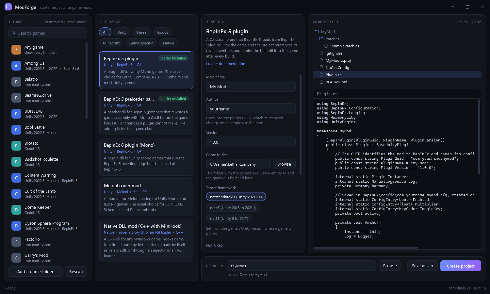

# ModForge

Starter projects for game mods. Pick a game, pick a kind of mod, set a few options, and get a project where every
file is already in the right place: the loader's entry point, the manifest, the build setup, the copy into the game.
Edit one file and you have a working mod.

One small exe (under 400 KB). Nothing to install: it runs on the .NET Framework 4.8 that Windows 10 and 11 already have.



**Status: early.** Every template passes the built-in check (each option combination rendered, every JSON and XML file
parsed), and the Unity, RimWorld and native C++ projects were compiled for real. None of the generated mods has been
loaded in a running game yet. The Minecraft, Unreal C++, Geode, tModLoader, SMAPI and Vintage Story projects were
checked against the official examples and docs but not compiled against the real game or SDK. Reports of a template that does not load are very welcome.

## Download

Get `ModForge.exe` from the [releases page](../../releases) and run it. It is not signed, so Windows SmartScreen may
ask you to confirm the first time.

## Templates

| Engine | Templates |
|---|---|
| Unity | BepInEx 5 plugin, BepInEx 6 plugin (IL2CPP and Mono), MelonLoader mod, BepInEx 5 preloader patcher |
| Unreal | UE4SS Lua mod, UE4SS C++ mod, pak mod (asset replacement), Blueprint logic mod |
| Godot | Godot Mod Loader mod |
| Minecraft (26.x) | Fabric mod, NeoForge mod, Paper plugin, datapack, resource pack, Bedrock add-on |
| Game specific | BeamNG.drive, Teardown, Trailmakers, Garry's Mod, Factorio, Balatro (Steamodded), Geometry Dash (Geode), Stardew Valley (SMAPI and Content Patcher), RimWorld, Terraria (tModLoader), Vintage Story |
| Any game | Native C++ DLL with MinHook: a version.dll proxy, an injectable dll, or an ASI plugin |

Every generated project has a README that explains its layout, how to build it, where it goes in the game, and the
usual reasons it silently fails to load.

## How it works

1. **Game.** ModForge reads your Steam and Epic libraries and works out each game's engine (Unity, Unreal, Godot),
   the Unity scripting backend (Mono or IL2CPP), the engine version, and which mod loaders are already installed
   (BepInEx 5 or 6, MelonLoader, UE4SS). You can also add any folder by hand, or pick "Any game".
2. **Template.** Only the templates that fit the game are listed, best match first.
3. **Set it up.** Name, author, and feature switches. The file tree and every file's contents update as you type,
   so you see exactly what you will get.
4. **Create.** A folder, or a zip.

When a game is picked the project is tied to it: references point at the game's own assemblies, the target
framework follows its Unity version, and a build copies the result into the right folder of the game.

## Where the templates come from

Templates are small text files with placeholders, composed on your PC. No AI and no server. Every variation is put
together from parts, so hundreds of combinations cost almost nothing in size.

- A set is built into the exe.
- **Update:** click the template version in the bottom right corner, paste the address of a pack zip (or a GitHub
  source zip of a repo that contains `pack.json`), and press Update. A newer pack replaces the built-in one.
- **Your own:** drop template folders into `%LOCALAPPDATA%\ModForge\packs`. They load next to the built-in ones.
  The format is in [docs/PACK-FORMAT.md](docs/PACK-FORMAT.md).

## Build

```
powershell -File build.ps1
```

The exe lands in `bin\publish\ModForge.exe`. Needs the .NET SDK (any recent one).

## Command line

The same exe has a mode with no window, used to test templates:

```
ModForge.exe --cli list
ModForge.exe --cli scan
ModForge.exe --cli validate [--packs <folder>] [template-id ...]
ModForge.exe --cli generate <template-id> --out <folder> [--zip <file>] [--set Name=Value] [--game <game folder>]
```

`validate` renders every template under every option combination, with and without a game, and checks that every
JSON and XML file that comes out parses.

`ModForge.exe --screenshot <file.png> [--demo] [--game <name>] [--select <template-id>]` draws the window to a PNG
without showing it. `--demo` shows a made-up game library instead of reading the real one.

## License

MIT. Projects you generate are yours: no licence is attached to them.

## Layout of this repo

| Path | What |
|---|---|
| `src/ModForge/Core` | The engine: pack loading, the template language, generation, game detection, the command line. |
| `src/ModForge` | The window (WPF). |
| `packs/` | The templates. One folder per template. Zipped into the exe at build time. |
| `docs/PACK-FORMAT.md` | How to write a template. |
